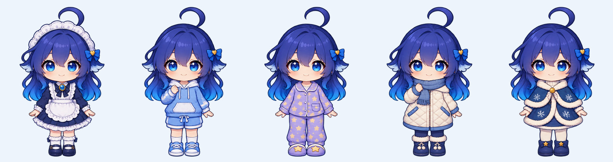
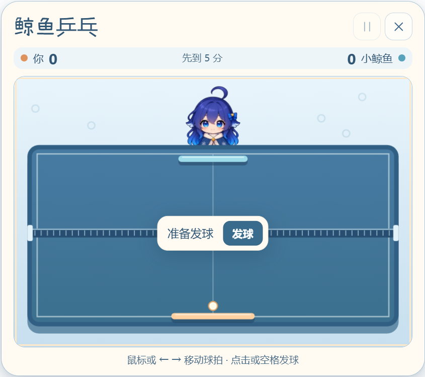
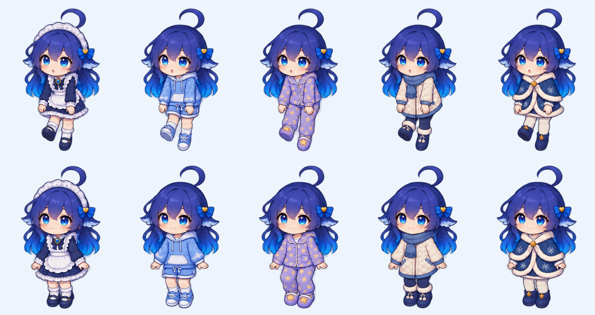

# Little Whale Desktop Pet

[简体中文](README.md) · [Download for Windows](https://github.com/nailiang002-wq/deepseek-girl-desktop/releases/latest)

Bring a little whale companion to your Windows desktop. Pat her head, feed her three bites of rice, dress her up, or play a quick game of table tennis. The app runs offline and works without DSH or an account.



## Download and run

1. Open [GitHub Releases](https://github.com/nailiang002-wq/deepseek-girl-desktop/releases/latest) and download `DeepSeekGirlDesktop-0.5.0-win-x64.zip`.
2. Extract the **entire** folder and double-click `小鲸鱼桌宠.exe` inside it.
3. If she goes missing, right-click the little whale in the system tray and choose “找回小鲸鱼 / 恢复位置” to reset her position. The tray also lets you toggle always-on-top, select a screen, or quit.

## Play together

| Action | What happens |
| --- | --- |
| Tap her head | Give her a pat. Three quick taps make her pout. |
| Click the rice bowl | She eats three bites, wipes her mouth and smiles. |
| Drag her | She dangles like a kitten lifted by the scruff, then lands softly when you let go. |
| Ctrl + mouse wheel | Resize her on the desktop. |
| Right-click → 更多 → 变身 Pro | Watch the transformation and switch between Flash and Pro. |
| Right-click → 换衣服 | Choose from five Flash outfits and three Pro outfits, each remembered separately. |
| Right-click → 更多 → 桌面互动 | Play table tennis, take a pointer-following walk, pop bubbles, or start a 15-, 25- or 45-minute focus session. |

In **Whale Table Tennis**, move your paddle with the mouse or arrow keys. Click the table or press Space to serve. The first to five points wins. The game pauses when you switch windows, and empty desktop space remains clickable.



All eight outfits have lift and landing poses. The top row below shows the lift; the bottom row shows the landing.



She greets you at different times of day and sometimes asks for rice when idle. The heart button below the interaction wheel opens the companion journal, where you can see your bond progress and choose a nickname. Both forms share settings and progress stored in `%APPDATA%\DeepSeekGirlDesktop`.

## Build from source

Use Windows x64 and Node.js 20 or later. Run these PowerShell commands from the repository root.

```powershell
npm run build
New-Item -ItemType Directory -Path .cache -Force | Out-Null
Invoke-WebRequest 'https://github.com/electron/electron/releases/download/v45.4.1/electron-v45.4.1-win32-x64.zip' -OutFile '.cache/electron-v45.4.1-win32-x64.zip'
npm run package
```

The packager checks the Electron archive against its SHA-256 and produces `dist/DeepSeekGirlDesktop-0.5.0-win-x64/`. Set `ELECTRON_RUNTIME_ZIP` to use a runtime archive you already have. To test the packaged app, run `npm install` followed by `npm test`.

This desktop app grew out of the [DeepSeek Girl Harness plugin](https://github.com/nailiang002-wq/deepseek-girl-harness). See the [third-party notices](THIRD_PARTY_NOTICES.md) for component licenses and font credits.
