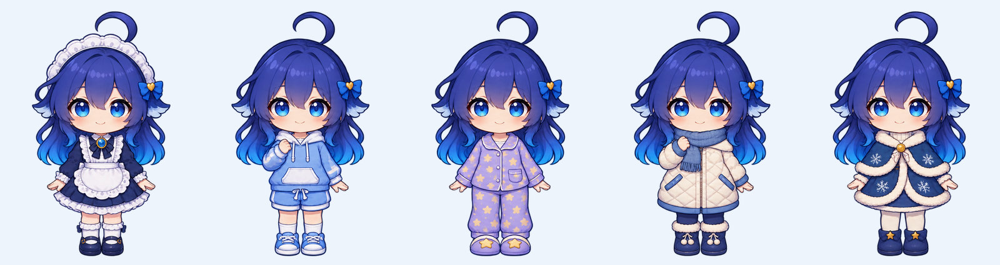
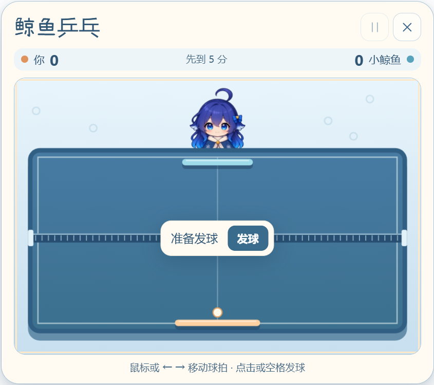
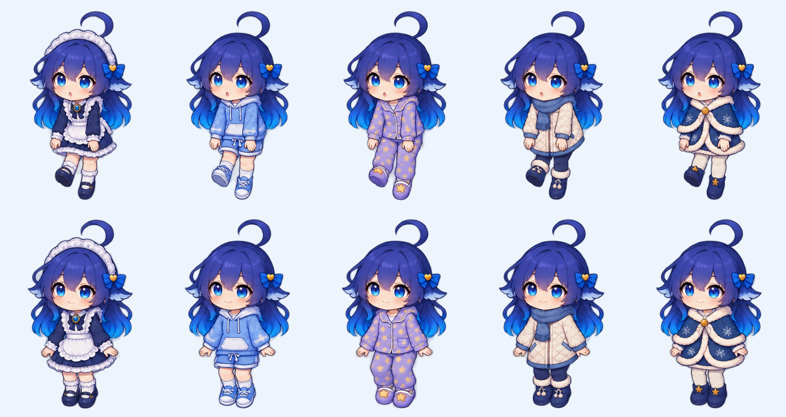

# 小鲸鱼桌宠

[English](README.en.md) · [下载 Windows 版](https://github.com/nailiang002-wq/deepseek-girl-desktop/releases/latest)

把小鲸鱼带到 Windows 桌面上。可以摸摸头、喂她三口白饭、给她换装，也可以和她打一局乒乓球。独立运行，无需安装 DSH 或登录，离线就能玩。



## 下载与启动

1. 打开 [GitHub Releases](https://github.com/nailiang002-wq/deepseek-girl-desktop/releases/latest)，下载 `DeepSeekGirlDesktop-0.5.0-win-x64.zip`。
2. 解压**整个**文件夹，再双击里面的 `小鲸鱼桌宠.exe`。
3. 找不到她时，右键任务栏托盘的小鲸鱼图标，选「找回小鲸鱼 / 恢复位置」。同一菜单可以关闭置顶、选择屏幕或退出。

## 和她怎么玩

| 操作 | 她会怎么做 |
| --- | --- |
| 轻点头部 | 接受摸头，快速点三次会鼓脸 |
| 点击白饭盆 | 吃三口饭，擦嘴，露出满足的表情 |
| 按住她拖动 | 像小猫被轻轻拎住后衣领一样放松手脚，松开后轻轻落地 |
| Ctrl + 滚轮 | 调整她的大小 |
| 右键 → 更多 → 变身 Pro | 播放变身动画，手动切换 Flash 和 Pro |
| 右键 → 换衣服 | 给 Flash 选 5 套、给 Pro 选 3 套，各自记住穿搭 |
| 右键 → 更多 → 桌面互动 | 打乒乓球、跟着光标散步、点泡泡，或开启 15／25／45 分钟专注陪伴 |

**鲸鱼乒乓**中，鼠标或左右键移动球拍，点击球桌或按空格发球，先到 5 分获胜。切到别的窗口会自动暂停。窗口空白区域会让鼠标穿过，方便继续使用桌面。



拎起和落地的动作覆盖两种形态的八套衣服。下图上排是拎起，下排是落地。



她会按时间打招呼，空闲时偶尔捧盆求饭。转轮下方的心形按钮可以打开陪伴手账，查看亲密度并设置称呼。进度和设置保存在 `%APPDATA%\DeepSeekGirlDesktop`，两种形态共用一份。

## 从源码构建

需要 Windows x64 和 Node.js 20 或更高版本。在仓库根目录执行以下 PowerShell 命令。

```powershell
npm run build
New-Item -ItemType Directory -Path .cache -Force | Out-Null
Invoke-WebRequest 'https://github.com/electron/electron/releases/download/v45.4.1/electron-v45.4.1-win32-x64.zip' -OutFile '.cache/electron-v45.4.1-win32-x64.zip'
npm run package
```

打包脚本会校验 Electron 压缩包的 SHA-256，生成 `dist/DeepSeekGirlDesktop-0.5.0-win-x64/`。也可以通过 `ELECTRON_RUNTIME_ZIP` 指定已下载的运行时。要运行打包程序的测试，先执行 `npm install`，再执行 `npm test`。

独立桌宠源自 [DeepSeek Girl Harness 插件](https://github.com/nailiang002-wq/deepseek-girl-harness)。项目保留了素材出处和[第三方许可证](THIRD_PARTY_NOTICES.md)。
